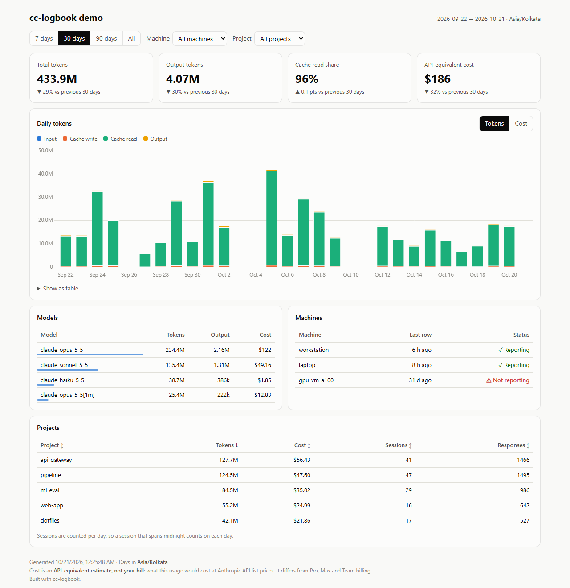

# cc-logbook

**A dashboard of your Claude Code token usage: local with zero setup, or synced across every machine you use.**

**[Live demo →](https://the-silent-geek.github.io/Claude-code-usage/)** (fake data: 3 machines, 5 projects, 60 days)



## Quick start

```sh
npx cc-logbook
```

It reads `~/.claude/projects` and opens a dashboard at `http://localhost:4545` with tokens and API-equivalent cost per day, model and project. No account, no network calls, nothing written to disk. Press **Refresh** on the page after more Claude Code work.

Just want numbers in the terminal? `npx cc-logbook preview`.

On a remote machine, VS Code Remote-SSH forwards the port automatically. Otherwise run `ssh -L 4545:localhost:4545 <host>` and open the URL locally.

Needs Node ≥ 18. No dependencies.

## Track several machines

If you use Claude Code on a laptop, a workstation and some short-lived GPU VMs, sync mode puts them all on one hosted dashboard and keeps each VM's history after it's deleted.

```sh
npx cc-logbook init
```

On the first machine, `init` does the following:

1. **Logs you in to GitHub** if needed, using the GitHub CLI (`gh`). You get a short code, open github.com/login/device on any device (your phone works), and type it in. This works on headless VMs too.
2. **Creates a private repo** (`cc-logbook-data`) in your account to hold the usage rows, and asks which timezone to count days in.
3. **Turns on hosting**: GitHub Pages if your plan allows it for private repos, otherwise it prints Cloudflare Pages steps (free).
4. **Schedules an hourly push** with cron and runs the first one.

On every other machine, run `npx cc-logbook init`, choose **existing** and paste the repo URL.

For a scheduled job that survives the npx cache being cleared, `init` offers to `npm i -g cc-logbook`.

> **About access:** logging in with `gh` gives this machine access to all your GitHub repos. On a shared machine, use the deploy-key option `init` prints instead. It only grants write access to the one data repo.

## Commands

```
cc-logbook              local dashboard on localhost (default)
cc-logbook preview      totals for today / 7 days / 30 days in the terminal
cc-logbook init         set up sync mode on this machine
cc-logbook push         export + commit + push (what cron runs)
cc-logbook build        aggregate a data repo into site/ (what the data repo's Action runs)
cc-logbook uninstall    remove the cron entry and config (keeps the data repo)

  --dir [label=]path    Claude config dir (repeatable; default ~/.claude, ~/.claude-*, $CLAUDE_CONFIG_DIR)
  --machine <name>      machine label (default $CC_LOGBOOK_MACHINE, then config, then hostname)
  --include <prefix>    only read projects whose alias starts with prefix (repeatable)
  --days <n>            only read the last n days
  --port <n>            local mode port (default 4545; tries the next 10 if busy)
  --no-open             don't open a browser
  --dry-run             push: do everything except write, commit or push
```

## How it works

```
LOCAL MODE (default)
  ~/.claude/projects ──parse──▶ rows ──aggregate──▶ data.json ──▶ http://127.0.0.1:4545

SYNC MODE (optional)
  machine A ─┐                          ┌──────── data repo (yours, private) ─────────┐
  machine B ─┼─ cc-logbook push ──git──▶│ data/<machine>/<YYYY-MM>.jsonl              │
  machine C ─┘   (cron, hourly)         │ cc-logbook.config.json                      │
                                        │ .github/workflows/build.yml                 │
                                        │   └─ npx cc-logbook build ─▶ site/ ─▶ Pages │
                                        └─────────────────────────────────────────────┘
```

Claude Code keeps a transcript of every session in `~/.claude/projects`. cc-logbook pulls one row per API response out of those transcripts: timestamp, model, project, session and token counts. Both modes share the same parser, aggregation, pricing and dashboard page.

**Dedup.** Claude Code writes one response as several transcript lines and copies earlier lines into resumed sessions. Rows are keyed by request id + message id, and repeated keys keep the max of each token count. Rows are deduped again across machines, so a `~/.claude` copied onto a VM isn't counted twice.

**Append-only.** In sync mode, `push` never deletes rows. If a VM's logs disappear, everything it already pushed stays. Running it with nothing new produces byte-identical files, so there are no empty commits.

## Privacy

| Read and exported | Never exported |
|---|---|
| Token counts, model id, timestamp | Prompt text, responses, tool inputs |
| Project alias (`ai-automated`) | File paths, working directories |
| Session UUID, account label (`default`, `work`) | Home directory, username |
| Machine label you chose | |

Project aliases come from the folder name Claude Code uses for each project. Projects under your home dir become the path relative to it (`/home/you/ai-automated` → `ai-automated`). Anything outside home becomes `other-<hash>`. You can rename aliases in `cc-logbook.config.json` (data repo) or `~/.config/cc-logbook/config.json` (local) without re-exporting. Use `--include` to read only some projects.

Local mode binds to `127.0.0.1` only and never writes to disk.

## Cost is an estimate

The dashboard shows **API-equivalent cost**: what the same tokens would cost at Anthropic API list prices. That includes 5-minute vs 1-hour cache writes and Haiku 5.5's long-prompt tier. It is **not your bill**: Pro, Max and Team plans are billed differently. Unknown models are listed as unpriced, never guessed.

## Hosting (sync mode)

| Option | Private repo | Cost | Notes |
|---|---|---|---|
| GitHub Pages | Needs a paid plan | — | The site is **publicly reachable** even if the repo is private |
| Cloudflare Pages | ✓ | Free | Build `npx cc-logbook build`, output `site`; add Cloudflare Access to limit who can view |
| Locally | ✓ | Free | `npx cc-logbook build` in your clone, then serve `site/` |

## Scheduling on macOS and Windows

`init` installs cron on Linux and macOS. On macOS it also prints a launchd plist if you prefer that. On Windows it prints the `schtasks` command to run. Task Scheduler setup isn't automated.

## Development

```sh
npm test                                  # node:test, no dependencies
node bin/cc-logbook.js --dir ./sample-logs
node demo/generate.mjs /tmp/demo && node bin/cc-logbook.js build --root /tmp/demo
```

`template/` is the source for the [cc-logbook-data-template](https://github.com/the-silent-geek/cc-logbook-data-template) repo that `init` creates data repos from.

Release: `npm pack`, then from another folder `npx ./cc-logbook-<version>.tgz` and `npx ./cc-logbook-<version>.tgz preview`. Then `npm publish`.

## Credits

Transcript parsing and the pricing table structure are adapted from [cc-spend](https://github.com/TODO/cc-spend) (MIT). Its copyright notice is kept in [LICENSE](LICENSE).

## License

MIT
